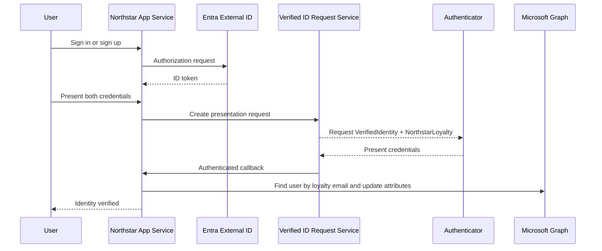

# External ID with Verified ID IDV

A Node.js travel demo for Azure App Service that combines Microsoft Entra External ID authentication with Microsoft Entra Verified ID identity verification. Northstar requests `VerifiedIdentity` and `NorthstarLoyalty` together, validates the callback, and updates External ID extension attributes through Microsoft Graph.

[](https://portal.azure.com/#create/Microsoft.Template/uri/https%3A%2F%2Fraw.githubusercontent.com%2Frogulati%2Feeid_with_vid_idv%2Fmain%2FARMTemplate%2Ftemplate.json/createUIDefinitionUri/https%3A%2F%2Fraw.githubusercontent.com%2Frogulati%2Feeid_with_vid_idv%2Fmain%2FARMTemplate%2FcreateUiDefinition.json)

## What the sample demonstrates

- External ID hosted sign-up and sign-in with MSAL for Node.
- Verified ID issuance for a `NorthstarLoyalty` credential.
- Combined presentation of `VerifiedIdentity` and `NorthstarLoyalty`.
- Claim extraction for loyalty email, loyalty number, and credential expiration.
- Microsoft Graph lookup and update of External ID custom attributes.
- Authenticated callbacks, CSRF protection, health checks, and focused tests.

## How it works



## Prerequisites

- An Azure subscription with permission to create App Service resources.
- A Microsoft Entra External ID tenant and combined sign-up/sign-in user flow.
- A web app registration with Microsoft Graph `User.ReadWrite.All` application permission and admin consent.
- A configured Verified ID authority.
- A `VerifiedIdentity` credential and a loyalty credential contract whose type is `NorthstarLoyalty` by default.
- Three External ID custom attributes for verification status, loyalty number, and Verified ID expiration.

## Deploy to Azure

The deployment wizard creates a Linux App Service plan and web app, configures application settings, enables logs and health checks, and deploys this repository from GitHub.

1. Select **Deploy to Azure** above.
2. Choose a resource group and globally unique web app name.
3. Enter the External ID application, Verified ID, and Graph extension attribute values.
4. Use random values of at least 32 characters for the session secret and callback API key.
5. After deployment, copy the `redirectUri` output.
6. Add that URI as a **Web** redirect URI on the External ID app registration.
7. Add the application to the External ID user flow, then browse to the `appUrl` output.

The B1 plan is recommended because it supports Always On. F1 is available for evaluation but can cold start, which may interrupt time-sensitive Verified ID callbacks.

> The template stores supplied secrets as App Service settings. For production, use managed identities and Azure Key Vault references instead.

## Repository structure

| Path | Purpose |
| --- | --- |
| `src/` | Express application, authentication, Verified ID, Graph, views, and static assets |
| `test/` | Node test suite and callback regression coverage |
| `infra/` | Maintainable Bicep source and example deployment parameters |
| `ARMTemplate/` | Generated ARM template and Azure portal deployment wizard |
| `.github/workflows/ci.yml` | Node tests and infrastructure syntax validation |

`infra/main.bicep` is the infrastructure source of truth. `ARMTemplate/template.json` is generated from it because the Azure portal deployment button consumes ARM JSON. Keep both, but make infrastructure changes in Bicep and regenerate the ARM file.

```powershell
az bicep build --file infra/main.bicep --outfile ARMTemplate/template.json
```

## Why hosted authentication

Browser-delegated (hosted) authentication is the recommended fit for this website: a redirect is natural, Microsoft owns the credential surface and security updates, and the app only handles the authorization response. Native authentication is useful when a browser redirect is unacceptable and the app must own every sign-in screen, but it adds credential-handling responsibility and maintenance. Microsoft currently supports both approaches for web apps; this demo deliberately chooses the safer, simpler hosted approach.

See [Choose native authentication or browser-delegated authentication](https://learn.microsoft.com/entra/external-id/customers/concept-choose-authentication-approach) for the Microsoft Entra External ID guidance.

## External ID setup

1. In the Microsoft Entra admin center, switch to the external tenant.
2. Go to **External Identities > User flows**, create a combined sign-up and sign-in flow, and choose the identity providers and attributes for the demo.
3. Register a **Web** application and add it to that user flow.
4. Add `http://localhost:3000/auth/redirect` as a Web redirect URI. Enable ID tokens if the portal presents that option.
5. Create a client secret for local development. Store its **value**, not its ID.
6. Add the Microsoft Graph application permission `User.ReadWrite.All` and grant admin consent. This lets the Verified ID callback update the signed-in user's verification attributes.
7. Create the required custom attributes and record their exact Microsoft Graph extension names.
8. Copy `.env.example` to `.env`, then fill in all required values. Never commit `.env`.

## Run locally

```powershell
Copy-Item .env.example .env
npm install
npm test
npm start
```

Open <http://localhost:3000> and select **Sign in or sign up**.

## Azure App Service settings

For manual deployment, create a Node 20+ Linux App Service and configure these application settings:

- `NODE_ENV=production`
- `ENTRA_TENANT_ID=<external-tenant-id>`
- `ENTRA_TENANT_SUBDOMAIN=<external-tenant-subdomain>`
- `ENTRA_CLIENT_ID=<application-client-id>`
- `ENTRA_CLIENT_SECRET=<secret-value-or-key-vault-reference>`
- `ENTRA_REDIRECT_URI=https://<app-name>.azurewebsites.net/auth/redirect`
- `VERIFIED_ID_AUTHORITY=<verified-id-authority-did>`
- `VERIFIED_ID_CALLBACK_API_KEY=<strong-random-value>`
- `VERIFIED_ID_MANIFEST=<loyalty-credential-manifest-url>`
- `VERIFIED_ID_TYPE=NorthstarLoyalty`
- `GRAPH_IS_VERIFIED_ATTRIBUTE=extension_<app-id-without-hyphens>_isVerified`
- `GRAPH_LOYALTY_ATTRIBUTE=extension_<app-id-without-hyphens>_loyalty`
- `GRAPH_VERIFIED_ID_EXPIRATION_ATTRIBUTE=extension_<app-id-without-hyphens>_VerifiedIDExpirationDate`
- `SESSION_SECRET=<strong-random-value-or-key-vault-reference>`

Add that exact HTTPS redirect URI to the app registration. Set the startup command to `npm start`, enable HTTPS-only and Always On, and configure `/health` as the health check path. For production, replace the default in-memory session store with a shared durable store and use a Key Vault reference for secrets.

## Security note

Displaying a raw ID token is appropriate only for this controlled demo. ID tokens are proof of authentication for the client application, not API authorization credentials. Do not log them, send them to telemetry, or expose them in a production page.