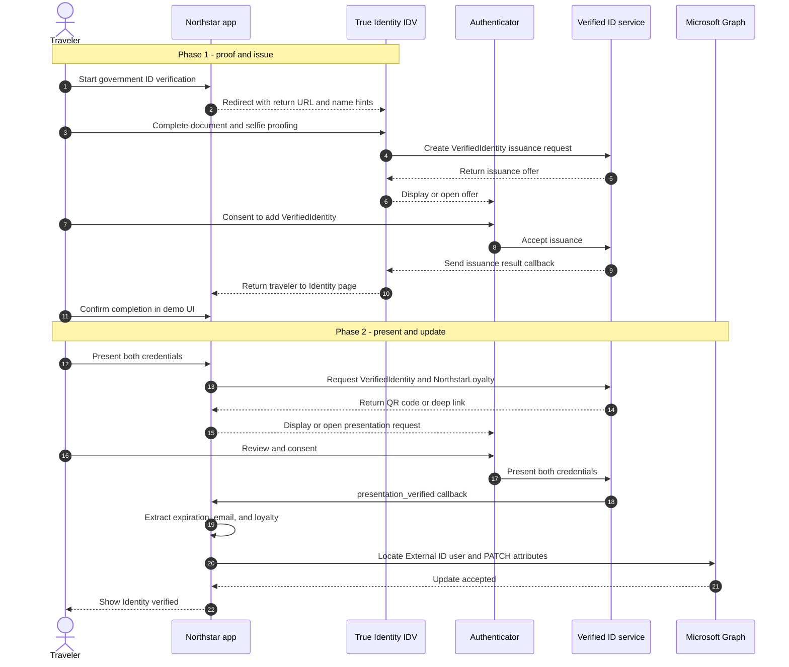
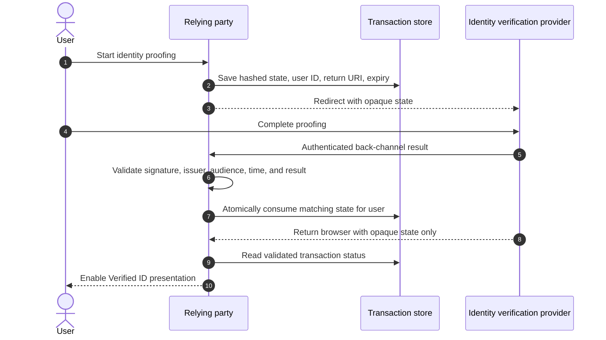

# Government ID and IDV integration

This document describes how the **Identity** page connects an external government identity verification (IDV) experience, Microsoft Entra Verified ID, Microsoft Authenticator, and an External ID user profile.

The flow follows the high-level issuer and verifier pattern in [Integrate Verified ID APIs](https://learn.microsoft.com/entra/verified-id/integration-guidance):

1. An IDV partner proofs the user and issues a Verified ID.
2. A relying-party application requests presentation of that credential.
3. Microsoft Authenticator obtains consent and presents the credential through the Verified ID Request Service.
4. The relying party consumes the verified claims.

Northstar extends the reference pattern by requesting **two credentials together** and then writing selected results to the External ID user through Microsoft Graph.

## End-to-end sequence

This compact sequence keeps the complete flow visible in GitHub and other Mermaid renderers. Browser redirects and pages are represented by Northstar or the IDV that owns them.

## How this compares with the Microsoft guidance

| Integration guidance | Northstar implementation |
| --- | --- |
| Relying party sends the user to an IDV offer or jump-start URL | `/identity/verify` redirects the browser to the True Identity IDV. |
| IDV performs proofing and issues a Verified ID through the Request Service | True Identity owns document/selfie proofing and `VerifiedIdentity` issuance. Its implementation is outside this repository. |
| IDV returns the user to the relying party | The IDV receives a Northstar `returnUrl`; the traveler then confirms continuation in the demo UI. |
| Verifier requests an IDV credential by type and issuer DID | Northstar calls `createPresentationRequest` for `VerifiedIdentity` and `NorthstarLoyalty` in one request. The current combined request identifies credentials by type and does not pin `acceptedIssuers`. |
| Authenticator displays the request and collects user consent | Northstar renders the Request Service QR code or `openid-vc` deep link. |
| Request Service validates the presentation and calls the verifier callback | Northstar handles `request_retrieved`, `presentation_verified`, and `presentation_error` at `/api/verifiedid/presentation-callback`. |
| Relying party uses verified claims for its business outcome | Northstar extracts claims from both credentials and updates the External ID user through Microsoft Graph. This is Northstar-specific. |
| Reference remote-onboarding flow can include Face Check | This demo does not request Face Check. |

## Northstar-specific claim mapping

A successful callback must contain both credential records:

| Credential | Value consumed | Destination |
| --- | --- | --- |
| `VerifiedIdentity` | `expirationDate` | `GRAPH_VERIFIED_ID_EXPIRATION_ATTRIBUTE` |
| `NorthstarLoyalty` | `claims.email` | External ID user lookup key |
| `NorthstarLoyalty` | `claims.loyalty` | `GRAPH_LOYALTY_ATTRIBUTE` |
| Combined success | Constant `Yes` | `GRAPH_IS_VERIFIED_ATTRIBUTE` |

The Graph lookup first matches an External ID identity by tenant issuer and issuer-assigned email. It falls back to `mail` or `userPrincipalName`, and the update proceeds only when exactly one user is found.

## Security guidance

The redirect back from an IDV is navigation, not evidence that identity proofing succeeded. A production relying party must unlock the presentation step only after it validates an authenticated IDV result that is bound to the signed-in user and the transaction it created.

### Secure the redirect to the IDV

1. Configure the IDV base URL on the server and allow only an exact HTTPS scheme, host, port, and expected path. Never accept the destination from a browser parameter.
2. Register exact return URIs with the IDV. Construct the selected URI from a server-side allowlist; do not reflect a caller-provided `returnUrl`, permit wildcards, or perform suffix-only hostname checks.
3. Create at least 256 bits of cryptographically random transaction state. Store a hash of it in a durable, expiring record bound to the signed-in user's immutable External ID object ID, the session, the intended operation, and the exact return URI.
4. Make the transaction short-lived and single-use. Mark it consumed atomically so browser refreshes and replayed responses cannot restart or complete another user's transaction.
5. Send only an opaque transaction identifier in the URL. Do not put names, email addresses, object IDs, session identifiers, proofing results, or other personal data in query strings because URLs leak through history, logs, analytics, screenshots, and referrer headers.
6. If the IDV requires input claims, send them through an authenticated back channel or a signed and, when confidentiality is required, encrypted request object. Validate its audience and expiry at the IDV. Use `Referrer-Policy: no-referrer` on the handoff page.
7. Enforce TLS, HSTS, and normal certificate validation on both sites. Do not follow redirects from the configured IDV endpoint to an unapproved origin.

### Secure the return from the IDV

A recommended production handoff is:

1. Prefer a server-to-server result authenticated with mutually authenticated TLS, OAuth client credentials, or a signed JWS/JWT. A browser-carried signed result can be used when a back channel is unavailable, but it still requires replay protection.
2. Pin the expected IDV issuer and trusted signing keys or JWKS endpoint, allowlist signature algorithms, and support controlled key rotation. Reject unsigned tokens and algorithm/key-type mismatches.
3. Validate `iss`, `aud`, `iat`, `nbf`, `exp`, a unique `jti`, transaction state, result status, and the binding to the expected user. Use a small, documented clock-skew allowance.
4. Compare the returned state with the stored transaction, consume it once, and reject missing, expired, already-used, or wrong-user transactions. Do not expose whether another user's transaction exists.
5. Treat a fixed return URI as routing only. Never interpret `?trueIdVerified=true`, a manual **I have been verified** action, or possession of a return URL as proofing success.
6. Keep detailed IDV errors server-side and show generic messages to the browser. Do not place proofing evidence or personal data in URL parameters.
7. For high-assurance actions, require recent user authentication and use an IDV assurance result appropriate to the business risk. Add Face Check or equivalent liveness/holder checks when policy requires them.

### Secure Verified ID presentation and callbacks

- Pin each expected credential issuer DID with `acceptedIssuers`. The current combined request specifies credential types but does not pin their issuers.
- Set `allowRevoked: false` for identity decisions unless a documented business policy explicitly accepts revoked credentials. `validateLinkedDomain` is useful phishing resistance, but it does not replace issuer allowlisting or revocation checks.
- Validate the credential type, issuer, expected contract/schema, issuance and expiration times, required claims, and presentation status before changing application or directory state.
- Bind both presented credentials to the same wallet holder and bind the result to the authenticated Northstar account using an immutable identifier or a pre-established account mapping. Do not use an email claim alone to select the Graph user; email can change and can create account-linking vulnerabilities.
- Authenticate Request Service callbacks with a secret held in Key Vault and rotate it. For stronger deployments, place the callback behind an API gateway that can add rate limits, source controls where supported, request validation, and monitoring. Never put callback secrets in source control or logs.
- Validate callback state against a durable transaction before processing claims. Handle duplicate, delayed, and out-of-order callbacks idempotently, and permit only one terminal transition per transaction.
- Keep the 1 MB callback body limit only as large as required, require JSON, validate the body against an explicit schema, reject unknown statuses, and apply request-rate and concurrency limits.
- Return success only after durable state and required downstream updates are committed. Use bounded timeouts and exponential backoff for transient Request Service and Graph failures without repeating non-idempotent business actions.

### Secure External ID and Microsoft Graph updates

- Use the object ID captured from the authenticated External ID session as the update target. Verify that presented claims belong to that account; avoid searching by loyalty email as the authoritative account-linking mechanism.
- Prefer an App Service managed identity for Microsoft Graph where the deployment supports it. Otherwise use a certificate credential whose private key is protected by Key Vault. Avoid long-lived client secrets.
- Grant the narrowest Graph application permission that supports the design, scope access operationally to this service, review administrator consent regularly, and alert on unexpected directory writes. `User.ReadWrite.All` is broad and should be treated as a high-impact permission.
- Allowlist the exact extension attributes the application may update. Validate lengths, formats, and expiration bounds before constructing the PATCH body.
- Make the directory update idempotent and auditable. Record transaction ID, result, target object ID, issuer, and timestamps, but redact credential payloads, document data, tokens, secrets, and unnecessary personal information.

### Protect state, sessions, and the web application

- Store IDV and presentation transactions in a shared durable store with encryption, TTL expiry, atomic consume/update operations, and cleanup. In-memory maps lose security state during restart and do not work safely across multiple instances.
- Use cookies with `Secure`, `HttpOnly`, and an appropriate `SameSite` policy; regenerate the session after authentication and privilege changes. Keep CSRF protection on all browser state-changing routes.
- Apply a restrictive Content Security Policy, `frame-ancestors`, HSTS, MIME sniffing protection, and output encoding. Review any cross-origin requirements for Authenticator deep links without weakening the whole site.
- Put secrets in Azure Key Vault, access them with managed identity, separate them by environment, rotate them, and prevent them from entering logs, deployment outputs, or client-side HTML.
- Minimize collected claims and retention. Define consent, purpose limitation, deletion, and regional/compliance requirements for government identity data before production use.
- Monitor failed state validation, callback authentication failures, replay attempts, issuer mismatches, Graph lookup anomalies, unusual write volume, and repeated proofing attempts. Correlate events with opaque transaction IDs rather than raw personal data.

## Demo and production use

This sample is built to demonstrate the concepts and end-to-end interactions involved in integrating an identity verification provider, Microsoft Entra Verified ID, Microsoft Authenticator, External ID, and Microsoft Graph. It intentionally simplifies parts of the security, reliability, privacy, operational, and lifecycle design so that the core flow is easier to understand.

**Do not use this sample as-is in a production environment.** Developers and administrators are responsible for completing a threat model and applying the security practices described in this guide before deploying the flow. They must also adapt the implementation to their organization's identity assurance requirements, data-protection obligations, regulatory controls, availability targets, monitoring standards, and incident-response processes.

Before production deployment, validate the complete design with the identity verification provider and the organization's security, identity, privacy, compliance, and operations teams. Test redirect and callback integrity, replay and failure handling, issuer and credential policies, account binding, secret and key rotation, least-privilege access, durable state, scaling behavior, auditability, and recovery procedures in a representative non-production environment.
